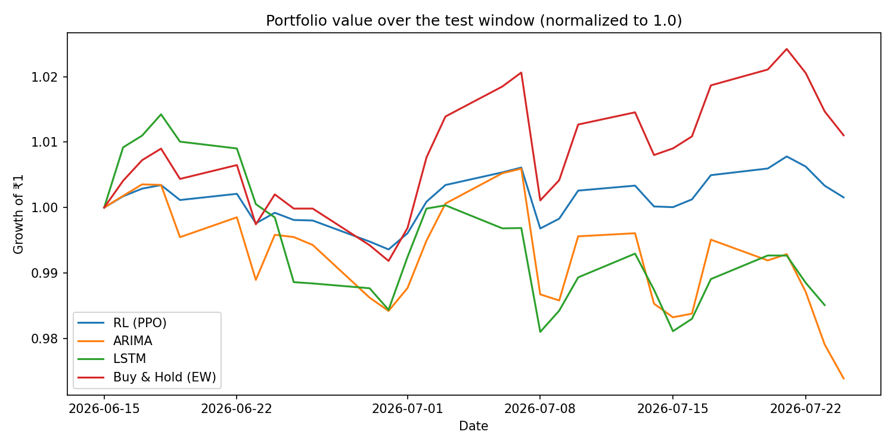

# Deep RL Portfolio Trading on NIFTY Stocks: FinSearch 2026

A **PPO reinforcement-learning agent** that allocates a long-only portfolio across 49 large-cap NIFTY stocks. It is benchmarked against **ARIMA**, **LSTM** and **equal-weight buy-and-hold** strategies on a held-out **six-week test window** (15 Jun to 24 Jul 2026), using return and risk metrics.

Built for **FinSearch 2026**, the research project run by the Finance Club, IIT Bombay (completed).

## Approach

**Data** (`data_collection.py`): daily OHLCV for 50 large-cap stocks from Yahoo Finance (2015 to Jul 2026). 49 had usable data. Technical features per stock: daily return, MA-10, MA-50, RSI-14, MACD and signal, Bollinger bands, 20-day volatility.

**Environment** (`trading_env.py`), a custom Gymnasium env:
- **State:** z-scored features for every stock, plus current holdings weights and cash ratio (501 dimensions).
- **Action:** a continuous vector in [−1, 1]⁴⁹. A softmax gives relative target weights, scaled by the mean action, so the agent can also sit in cash. Long-only, no leverage.
- **Costs:** 0.1% transaction cost on traded value.
- **Reward:** `log(V_t / V_{t−1}) − λ · rolling_std(returns)`, a risk-penalised log return (λ = 0.1), so the agent is not purely return-chasing.

**Agent** (`train_rl_agent.py`): PPO (Stable-Baselines3, MLP policy), trained for about 200k steps on 2015 to Jun 2026 data. PPO was chosen over DDPG for stability with a high-dimensional continuous action space.

**Benchmarks** (`benchmarks.py`), using the same long-only, equal-weight constraints:
- **ARIMA(1,1,1)** per stock on log-price with a rolling 250-day fit. Go long if the one-step forecast is above today's price.
- **LSTM** (2 layers, 64 units) on 20-day feature sequences, predicting next-day return. Go long the top-10 predicted stocks daily.
- **Buy & hold:** equal-weight across all 49 stocks.

**Metrics** (`evaluate_compare.py`): cumulative and annualised return, annualised volatility, Sharpe, Sortino (risk-free rate 6%), max drawdown, 95% daily VaR.

## Results (test window: 30 trading days, 15 Jun to 24 Jul 2026)

| Strategy | Cum. return | Ann. volatility | Sharpe | Sortino | Max drawdown | VaR 95% (daily) |
|---|---|---|---|---|---|---|
| **RL (PPO)** | **+0.16%** | **4.6%** | −0.98 | −1.16 | **−0.98%** | **−0.40%** |
| ARIMA | −2.61% | 10.6% | −2.69 | −3.47 | −3.19% | −1.03% |
| LSTM | −1.49% | 9.1% | −2.10 | −2.81 | −3.28% | −0.94% |
| Buy & Hold (EW) | **+1.10%** | 9.6% | **0.41** | **0.49** | −1.91% | −0.80% |

<p align="center"></p>

**Takeaways**
- **The RL agent beat both forecasting benchmarks**, with a positive return where ARIMA and LSTM lost money. It also had the **lowest risk on every measure**: about half the volatility, drawdown and VaR of buy-and-hold. The volatility penalty in the reward clearly shaped a defensive policy.
- **It did not beat buy-and-hold on return or Sharpe** in this window. The agent held part of the portfolio in cash during a mildly rising market, giving up upside for lower risk.
- Sharpe ratios are negative for most strategies because a 6% annual risk-free rate is a high bar over a six-week window with small absolute returns.

### Robustness checks
`evaluate.py` reruns the whole evaluation end-to-end (`results/reproduced_comparison.csv`):

| Check | RL cum. return | Ann. volatility | Sharpe | Max drawdown |
|---|---|---|---|---|
| Submitted model, rerun | +0.11% | 4.7% | −1.05 | −0.96% |
| Submitted model, **features scaled with training-period statistics only** (no look-ahead) | +0.13% | 4.6% | −1.03 | −0.96% |
| **Retrained from scratch** (`train_rl_agent.py --seed 0`, 200k steps) | **+0.47%** | 4.6% | −0.39 | −0.94% |

- **Look-ahead is not driving the result.** The original environment z-scored test features using test-window statistics. Fixing it (`norm_stats`) changes the return by only 0.02 percentage points.
- **The behaviour reproduces.** A freshly trained agent lands on the same low-risk policy: about half the volatility and drawdown of buy-and-hold, with a positive return.
- In the rerun, buy-and-hold matches exactly (+1.10%). ARIMA (−1.86%) and LSTM (−0.31%) differ from the submitted run, because the LSTM retrains with fresh random initialisation. The ranking holds: buy-and-hold > RL > LSTM > ARIMA.

## Limitations and next steps

- **A 30-day test window is short.** The differences are not statistically significant. Next step: walk-forward evaluation over many rolling windows.
- Single train/test split and no hyperparameter search for PPO or λ. Long-only, with no shorting or position limits.
- Next steps: compare DDPG/SAC and a DQN with discrete buy/hold/sell actions, add market-regime features, and use a differential-Sharpe reward.

## Run it

```bash
pip install -r requirements.txt
python run_demo.py                     # 1-minute smoke test on synthetic data (no download)
python data_collection.py              # download data -> data/nifty100_features.parquet
python train_rl_agent.py               # train PPO -> models/ppo_trader.zip
python evaluate.py --extra-models models/ppo_retrained_seed0.zip   # RL vs ARIMA vs LSTM vs buy & hold -> results/
```

Trained models are included: `models/ppo_trader.zip` (the submitted model) and `models/ppo_retrained_seed0.zip` (the retraining check). Market data is not redistributed. Regenerate it with `data_collection.py`.

## Files

| File | Purpose |
|---|---|
| `data_collection.py` | Yahoo Finance download + technical indicators |
| `trading_env.py` | Gymnasium portfolio environment (state, action, reward, costs) |
| `train_rl_agent.py` | PPO training |
| `benchmarks.py` | ARIMA and LSTM strategies |
| `evaluate_compare.py` | Return and risk metrics, comparison plot |
| `evaluate.py` | End-to-end evaluation on the test window |
| `run_demo.py` | Synthetic-data smoke test |

---
Manas Jagtap · Dual Degree, Electrical Engineering, IIT Bombay · FinSearch 2026, Finance Club IIT Bombay
